<h1 align="center"><pre> ╦╔═╗╔═╗╔╗╔ ╔═╗╔═╗
 ║╚═╗║ ║║║║═╠═╣╚═╗
╚╝╚═╝╚═╝╝╚╝ ╩ ╩╚═╝</pre></h1>

<details>
<summary>Table of Contents</summary>

- [Installation](#installation)
- [Docs](#docs)
- [Usage](#usage)
- [Examples](#examples)
  - [Omitting Fields](#omitting-fields)
  - [Using Nullable Primitives](#using-nullable-primitives)
  - [Working with Unknown or Dynamic Data](#working-with-unknown-or-dynamic-data)
  - [Using Raw JSON Strings](#using-raw-json-strings)
  - [Working with Enums](#working-with-enums)
  - [Using Custom Serializers or Deserializers](#using-custom-serializers-or-deserializers)
  - [Overriding built-in Container Types](#overriding-built-in-container-types)
- [Performance](#performance)
  - [Real-World Throughput](#real-world-throughput)
  - [Comparison to JavaScript](#comparison-to-javascript)
  - [Library Comparison](#library-comparison)
  - [Runtime Comparison](#runtime-comparison)
  - [Lazy Fields](#lazy-fields)
  - [Performance Tuning](#performance-tuning)
  - [Running Benchmarks Locally](#running-benchmarks-locally)
- [Debugging](#debugging)
- [Contributing](#contributing)
- [Who uses it?](#who-uses-it)
- [License](#license)
- [Contact](#contact)

</details>

## Installation

```bash
npm install json-as
```

Add the `--transform` to your `asc` command (e.g. in package.json)

```bash
--transform json-as
```

Alternatively, add it to your `asconfig.json`

```typescript
{
  "options": {
    "transform": ["json-as"]
  }
}
```

Optionally, for additional performance, also add this to your `asc` command:

```bash
--enable simd
```

## Docs

You can read the docs here:

<https://docs.jairus.dev/json-as>

## Usage

```typescript
import { JSON } from "json-as";

@json
class Vec3 {
  x: f32 = 0.0;
  y: f32 = 0.0;
  z: f32 = 0.0;
}

@json
class Player {
  @alias("first name")
  firstName!: string;
  lastName!: string;
  lastActive!: i32[];
  // Drop in a code block, function, or expression that evaluates to a boolean
  @omitif((self: Player) => self.age < 18)
  age!: i32;
  @omitnull()
  pos!: Vec3 | null;
  isVerified!: boolean;
}

const player: Player = {
  firstName: "Jairus",
  lastName: "Tanaka",
  lastActive: [3, 9, 2025],
  age: 18,
  pos: {
    x: 3.4,
    y: 1.2,
    z: 8.3,
  },
  isVerified: true,
};

const serialized = JSON.stringify<Player>(player);
const deserialized = JSON.parse<Player>(serialized);

console.log("Serialized    " + serialized);
console.log("Deserialized  " + JSON.stringify(deserialized));
```

## Examples

### Omitting Fields

This library allows selective omission of fields during serialization using the following decorators:

**@omit**

This decorator excludes a field from serialization entirely.

```typescript
@json
class Example {
  name!: string;
  @omit
  SSN!: string;
}

const obj = new Example();
obj.name = "Jairus";
obj.SSN = "123-45-6789";

console.log(JSON.stringify(obj)); // { "name": "Jairus" }
```

**@omitnull**

This decorator omits a field only if its value is null.

```typescript
@json
class Example {
  name!: string;
  @omitnull()
  optionalField!: string | null;
}

const obj = new Example();
obj.name = "Jairus";
obj.optionalField = null;

console.log(JSON.stringify(obj)); // { "name": "Jairus" }
```

**@omitif((self: this) => condition)**

This decorator omits a field based on a custom predicate function.

```typescript
@json
class Example {
  name!: string;
  @omitif((self: Example) => self.age <= 18)
  age!: number;
}

const obj = new Example();
obj.name = "Jairus";
obj.age = 18;

console.log(JSON.stringify(obj)); // { "name": "Jairus" }

obj.age = 99;

console.log(JSON.stringify(obj)); // { "name": "Jairus", "age": 99 }
```

If age were higher than 18, it would be included in the serialization.

**@optional**

This decorator marks a field as optional for deserialization: the key may be absent from (or appear in any order in) the input, and the field keeps its default. Unlike `@omitnull` and `@omitif`, it does not affect serialization - the field is always emitted - and it has no nullability requirement. It only opts the field into the order-tolerant fast path on parse.

```typescript
@json
class Tweet {
  text!: string;
  @optional
  retweeted_status: Retweet | null = null; // key may be absent
}

const tweet = JSON.parse<Tweet>('{ "text": "hello" }');
console.log(tweet.retweeted_status); // null (key was absent)
```

### Using nullable primitives

AssemblyScript doesn't support using nullable primitive types, so instead, json-as offers the `JSON.Box` class to remedy it.

For example, this schema won't compile in AssemblyScript:

```typescript
@json
class Person {
  name!: string;
  age: i32 | null = null;
}
```

Instead, use `JSON.Box` to allow nullable primitives:

```typescript
@json
class Person {
  name: string;
  age: JSON.Box<i32> | null = null;
  constructor(name: string) {
    this.name = name;
  }
}

const person = new Person("Jairus");
console.log(JSON.stringify(person)); // {"name":"Jairus","age":null}

person.age = new JSON.Box<i32>(18); // Set age to 18
console.log(JSON.stringify(person)); // {"name":"Jairus","age":18}
```

### Working with unknown or dynamic data

Sometimes it's necessary to work with unknown data or data with dynamic types.

Because AssemblyScript is a statically-typed language, that typically isn't allowed, so json-as provides the `JSON.Value` and `JSON.Obj` types.

Here's a few examples:

**Working with multi-type arrays**

When dealing with arrays that have multiple types within them, eg. `["string",true,["array"]]`, use `JSON.Value[]`

```typescript
const a = JSON.parse<JSON.Value[]>('["string",true,["array"]]');
console.log(JSON.stringify(a[0])); // "string"
console.log(JSON.stringify(a[1])); // true
console.log(JSON.stringify(a[2])); // ["array"]
```

**Working with unknown objects**

When dealing with an object with an unknown structure, use the `JSON.Obj` type

```typescript
const obj = JSON.parse<JSON.Obj>('{"a":3.14,"b":true,"c":[1,2,3],"d":{"x":1,"y":2,"z":3}}');

console.log("Keys: " + obj.keys().join(" ")); // a b c d
console.log(
  "Values: " +
    obj
      .values()
      .map<string>((v) => JSON.stringify(v))
      .join(" "),
); // 3.14 true [1,2,3] {"x":1,"y":2,"z":3}

const y = obj.get("d")!.get<JSON.Obj>().get("y")!;
console.log('o1["d"]["y"] = ' + y.toString()); // o1["d"]["y"] = 2
```

**Working with dynamic types within a schema**

More often, objects will be completely statically typed except for one or two values.

In such cases, `JSON.Value` can be used to handle fields that may hold different types at runtime.

```typescript
@json
class DynamicObj {
  id: i32 = 0;
  name: string = "";
  data!: JSON.Value; // Can hold any type of value
}

const obj = new DynamicObj();
obj.id = 1;
obj.name = "Example";
obj.data = JSON.parse<JSON.Value>('{"key":"value"}'); // Assigning an object

console.log(JSON.stringify(obj)); // {"id":1,"name":"Example","data":{"key":"value"}}

obj.data = JSON.Value.from<i32>(42); // Changing to an integer
console.log(JSON.stringify(obj)); // {"id":1,"name":"Example","data":42}

obj.data = JSON.Value.from("a string"); // Changing to a string
console.log(JSON.stringify(obj)); // {"id":1,"name":"Example","data":"a string"}
```

**Working with nullable primitives and dynamic data**

```ts
const box = JSON.Box.from<i32>(123);
const value = JSON.Value.from<JSON.Box<i32> | null>(box);
const reboxed = JSON.Box.fromValue<i32>(value); // Box<i32> | null
console.log(reboxed !== null ? reboxed.toString() : "null");
// 123

const parsedValue = JSON.parse<JSON.Value>("123");
const boxed = JSON.Box.fromValue<i32>(parsedValue);
console.log(boxed !== null ? boxed.toString() : "null");
// 123
```

Numeric dynamic getters (`Value.get<T>()`, `Value.as<T>()`, `Obj.getAs<T>()`,
and `Arr.getAs<T>()`) convert stored booleans and numbers to the requested
numeric type using AssemblyScript casts, without allocating a wrapper:

```ts
const value = JSON.parse<JSON.Value>("7.5");
value.get<i32>(); // 7
value.get<f32>(); // 7.5

const wide = JSON.Value.from<u64>(9007199254740993);
wide.get<u64>(); // 9007199254740993, exact
wide.get<f64>(); // 9007199254740992, rounded to f64 precision
```

Narrowing and floating-point conversion follow native casts. Boolean reads
compare the stored numeric value with zero; null retains the zero/false result.
Strings and objects are not coerced to numbers. `Box.fromValue<T>()` remains
available when a nullable boxed result is needed.

### Using Raw JSON strings

Sometimes its necessary to simply copy a string instead of serializing it.

For example, the following data would typically be serialized as:

```typescript
const map = new Map<string, string>();
map.set("pos", '{"x":1.0,"y":2.0,"z":3.0}');

console.log(JSON.stringify(map));
// {"pos":"{\"x\":1.0,\"y\":2.0,\"z\":3.0}"}
// pos's value (Vec3) is contained within a string... ideally, it should be left alone
```

If, instead, one wanted to insert Raw JSON into an existing schema/data structure, they could make use of the JSON.Raw type to do so:

```typescript
const map = new Map<string, JSON.Raw>();
map.set("pos", new JSON.Raw('{"x":1.0,"y":2.0,"z":3.0}'));

console.log(JSON.stringify(map));
// {"pos":{"x":1.0,"y":2.0,"z":3.0}}
// Now its properly formatted JSON where pos's value is of type Vec3 not string!
```

### Working with enums

By default, enums with values other than `i32` arn't supported by AssemblyScript. However, you can use a workaround:

```typescript
namespace Foo {
  export const bar = "a";
  export const baz = "b";
  export const gob = "c";
}

type Foo = string;

const serialized = JSON.stringify<Foo>(Foo.bar);
// "a"
```

### Using custom serializers or deserializers

This library supports custom serialization and deserialization methods, which can be defined using the `@serializer` and `@deserializer` decorators.

Custom serializers and deserializers must always speak valid JSON. You can optionally provide the JSON value shape they operate on using one of: `"any"`, `"string"`, `"number"`, `"object"`, `"array"`, `"boolean"`, or `"null"`. If omitted, the shape defaults to `"any"`.

Here's an example of creating a custom data type called `Point` which serializes to a JSON string:

```typescript
@json
class Point {
  x: f64 = 0.0;
  y: f64 = 0.0;
  constructor(x: f64, y: f64) {
    this.x = x;
    this.y = y;
  }

  @serializer("string")
  serializer(self: Point): string {
    return JSON.stringify(`${self.x},${self.y}`);
  }

  @deserializer("string")
  deserializer(data: string): Point {
    const raw = JSON.parse<string>(data);
    if (!raw.length) throw new Error("Could not deserialize provided data as type Point");

    const c = raw.indexOf(",");
    const x = raw.slice(0, c);
    const y = raw.slice(c + 1);

    return new Point(f64.parse(x), f64.parse(y)); // NEVER use this in deserializers. Always return a new instance
  }
}

const obj = new Point(3.5, -9.2);

const serialized = JSON.stringify<Point>(obj);
const deserialized = JSON.parse<Point>(serialized);

console.log("Serialized    " + serialized);
console.log("Deserialized  " + JSON.stringify(deserialized));
```

The serializer function converts a `Point` instance into a valid JSON string value.

The deserializer function parses that JSON string back into a `Point` instance.

Custom deserializers should always instantiate and return a new object. They should not assume an existing destination instance will be passed in or reused.

These functions are then wrapped before being consumed by the json-as library:

```typescript
__SERIALIZE_CUSTOM(): void {
  const data = this.serializer(this);
  const dataSize = data.length << 1;
  memory.copy(bs.offset, changetype<usize>(data), dataSize);
  bs.offset += dataSize;
}

_DESERIALIZE_CUSTOM(data: string): Point {
  return this.deserializer(data);
}
```

This allows custom serialization while maintaining a generic interface for the library to access.

### Overriding built-in container types

Undecorated subclasses of built-in container types keep the built-in JSON behavior.

This rule applies consistently across:

- `JSON.stringify(...)`
- `JSON.parse<T>(...)`
- `JSON.Value.from(...)`
- `JSON.internal.stringify(...)`
- `JSON.internal.parse(...)`

For example:

- `class MyBytes extends Uint8Array {}` still serializes like a normal `Uint8Array`
- `class MyMap extends Map<string, i32> {}` still serializes like a normal `Map<string, i32>`
- the same applies to subclassable built-ins such as `Array`, `Set`, and typed arrays

If you decorate that subclass with `@json`, it is treated as a normal generated class instead of inheriting the built-in container behavior. That means generated `__SERIALIZE` / `__DESERIALIZE` logic and custom serializer/deserializer hooks can take over.

If you want a different wire format, decorate the subclass with `@json` and provide custom `@serializer(...)` / `@deserializer(...)` methods:

```typescript
function hexDigit(value: u8): string {
  return String.fromCharCode(value < 10 ? 48 + value : 87 + value);
}

function parseHexNibble(code: u16): u8 {
  if (code >= 48 && code <= 57) return <u8>(code - 48);
  if (code >= 97 && code <= 102) return <u8>(code - 87);
  return <u8>(code - 55);
}

@json
class HexBytes extends Uint8Array {
  constructor(length: i32 = 0) {
    super(length);
  }

  @serializer("string")
  serializer(self: HexBytes): string {
    let out = "";
    for (let i = 0; i < self.length; i++) {
      const value = unchecked(self[i]);
      out += hexDigit(value >> 4);
      out += hexDigit(value & 0x0f);
    }
    return JSON.stringify(out);
  }

  @deserializer("string")
  deserializer(data: string): HexBytes {
    const raw = JSON.parse<string>(data);
    const out = new HexBytes(raw.length >> 1);

    for (let i = 0, j = 0; i < raw.length; i += 2, j++) {
      const hi = parseHexNibble(<u16>raw.charCodeAt(i));
      const lo = parseHexNibble(<u16>raw.charCodeAt(i + 1));
      unchecked((out[j] = <u8>((hi << 4) | lo)));
    }

    return out;
  }
}

const bytes = new HexBytes(4);
bytes[0] = 10;
bytes[1] = 20;
bytes[2] = 30;
bytes[3] = 40;

JSON.stringify(bytes);      // "\"0a141e28\""
JSON.parse<HexBytes>("\"0a141e28\"");
```

This same pattern works for subclassable built-ins like `Array`, `Map`, `Set`, and typed arrays.

`ArrayBuffer` and `String` are `@final` in AssemblyScript, so they cannot be subclassed there.

## Performance

`json-as` is engineered for **multi-GB/s** serialization and deserialization. I've handwritten and ideated every single algorithm from scratch with no outside resources. Every `@json` schema is compiled to specialized WebAssembly at build time, and bytes are scanned by one of three interchangeable backends:

- **NAIVE** — a portable, branchy scalar scanner. The correctness baseline; needs no special CPU features.
- **SWAR** — *SIMD-Within-A-Register*: processes 8 bytes at a time with ordinary 64-bit integer math. The default.
- **SIMD** — true 128-bit vector scanning. Fastest on large and string-heavy payloads; enable with `--enable simd`.

📊 **[Browse the full chart set for this release →](https://github.com/JairusSW/json-as/tree/docs/charts/v2.0.0)**

### Real-World Throughput

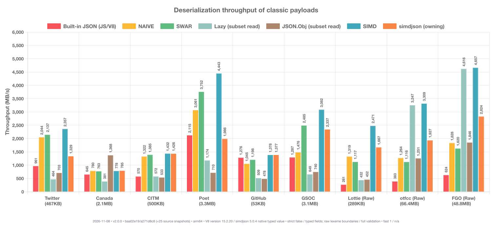


### Comparison to JavaScript

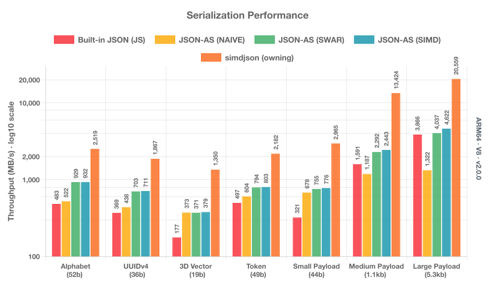

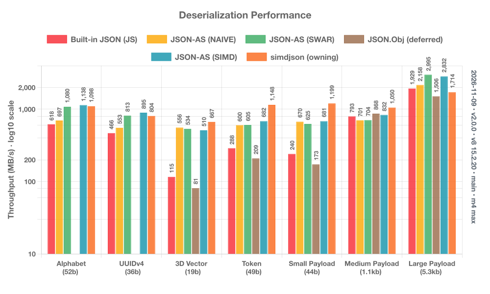

<details>
<summary>String serialization chart (click to expand)</summary>

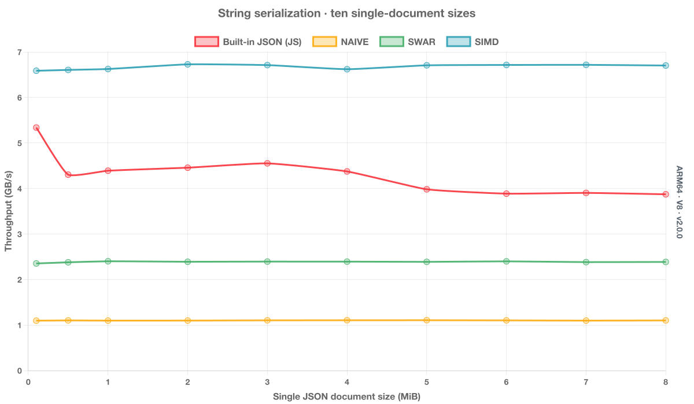

</details>

<details>
<summary>String deserialization chart (click to expand)</summary>

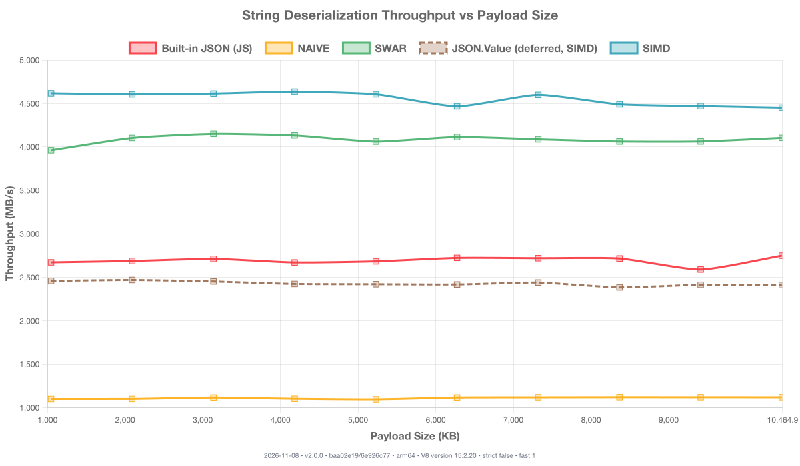

</details>

<details>
<summary>Object serialization chart (click to expand)</summary>

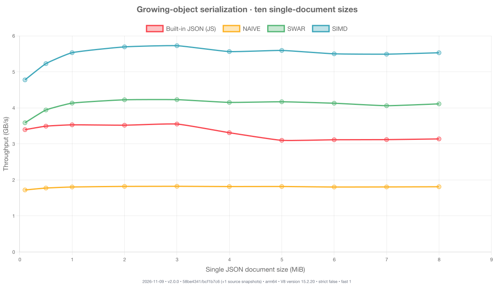

</details>

<details>
<summary>Object deserialization chart (click to expand)</summary>

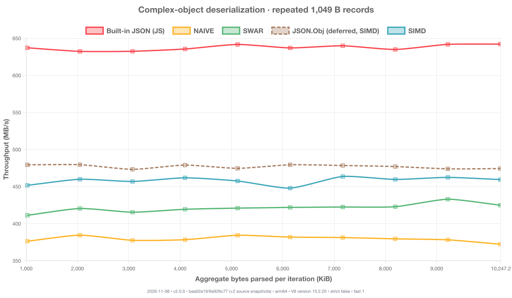

</details>

<details>
<summary>Primitive (de)serialize charts (click to expand)</summary>

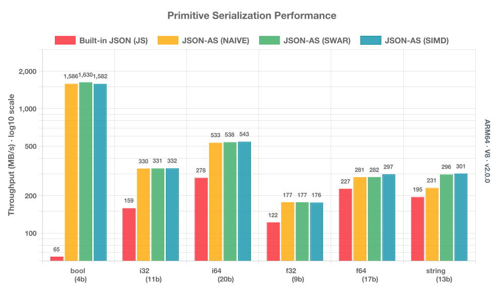

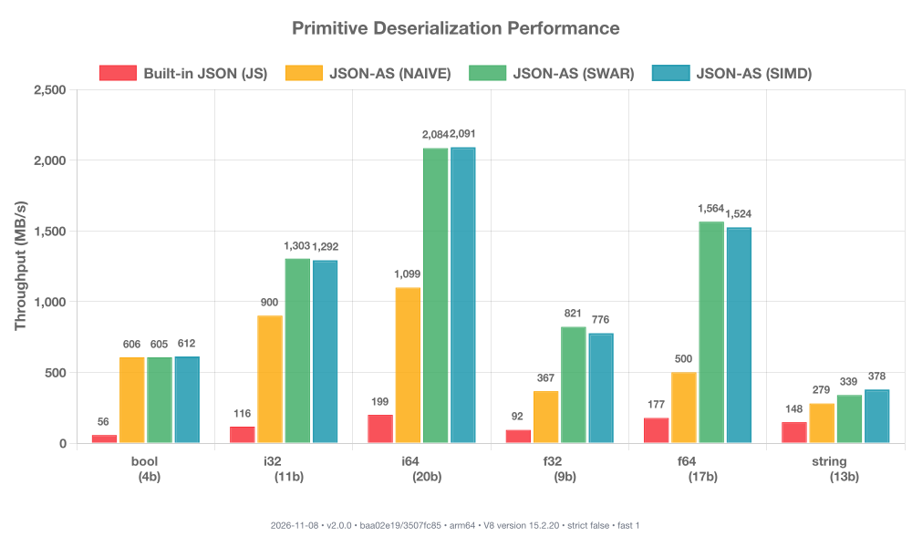
</details>

### Library Comparison

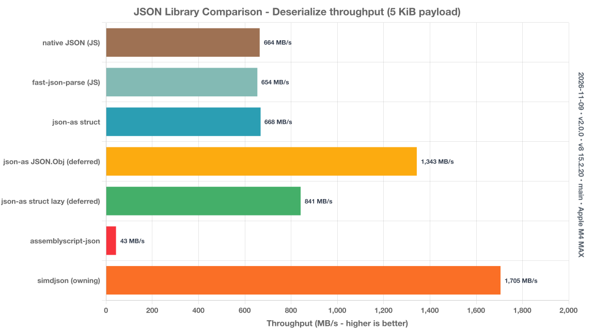


### Runtime Comparison

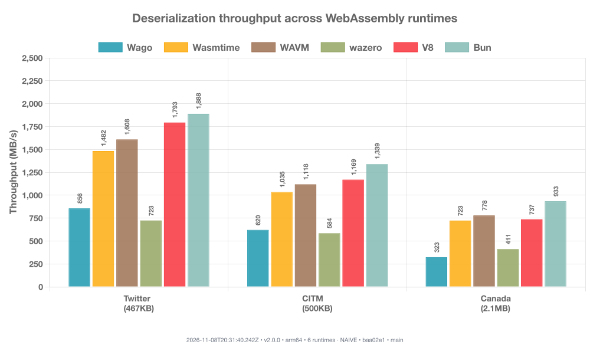

<details>
<summary>Serialization throughput (click to expand)</summary>

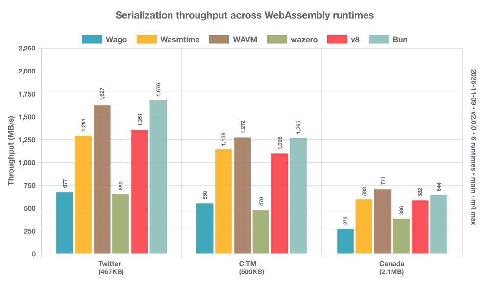
</details>

### Lazy Fields

Ordinary `@json` parsing also uses access analysis by default. When a visible
`JSON.parse<T>` result stays local, the transform can generate a reader that
scans proven-unused fields without decoding them. For example:

```ts
@json
class Point {
  x: f32 = 0;
  y: f32 = 0;
  name: string = "";
}

function readX(input: string): f32 {
  const point = JSON.parse<Point>(input);
  return point.x; // y and name can be skipped at this local parse site
}
```

Here, the transform can prove that only `point.x` is observed. It scans `y` and `name` without decoding them. Returning the object, passing it to unknown code, or serializing it whole keeps every observable field.

You can also disable this like so. I'd reccomend using this for benchmarks.
```ts
@json({ nolazy })
class EagerPoint {
  x: f32 = 0;
  y: f32 = 0;
}
```

For deferred serialization, use explicit lazy fields or a strategic class:

```ts
@json({ lazy: "strategic" })
class Response {
  id: i32 = 0;
  description: string = "";
}

function forward(input: string): string {
  const response = JSON.parse<Response>(input);
  if (response.id == 0) return "";
  return JSON.stringify(response);
}
```

The visible read makes `id` eager. An untouched deferred `description` is
serialized by copying its original JSON range, without decoding or re-escaping
it. Reads after the first serialization do not pull decoding ahead of that
output. `JSON.stringify` calls bound to json-as preserve this strategic read plan,
including imported aliases and namespace imports. An application-owned method
named `stringify` is handled conservatively.

Reading a deferred field materializes it; subsequent serialization encodes its
current value. Assignments replace the saved range, and mutations through a
materialized child are included. Omission decorators still apply. An untouched
custom-codec field invokes neither decoder nor serializer; accessing or replacing
it restores the typed codec path. This is per-field source forwarding, not a
cache of the whole output string. Array-typed fields remain eager; dynamic
`JSON.Arr` elements retain their existing deferred behavior.

Ordinary `@json` access specialization does not retain deferred source ranges.
Whole-object serialization therefore keeps its ordinary fields eager rather
than dropping fields that the serializer observes. `@json({ nolazy })` remains
an eager control for benchmarks.

### Performance Tuning

Instead of using flags for setting options, `json-as` is configured by environmental variables.
Here's a short list:

**JSON_CACHE** (default: 0) - Controls the experimental internal string-cache API. Regular serialization does not use this cache; enabling it does not accelerate `JSON.stringify`. Cache storage is allocated lazily, and a disabled cache has no arena storage. Accepts `true|false`, raw bytes (`JSON_CACHE=1048576`), bits (`JSON_CACHE=512kb`, `2mb`, `1gb`), and bytes (`JSON_CACHE=64KB`, `2MB`, `1GB`).

**JSON_DEBUG** (default: 0) - Sets the debug level. May be within range `0-3`

**JSON_MODE** (default: SWAR) - Selects which mode should be used. Can be `NAIVE,SWAR,SIMD`. Note that `--enable simd` may be required.

**JSON_STRICT** (default: false) - Set to `true` when compiling for complete JSON syntax validation through the checked parser or validated fallback.

**JSON_DIAGNOSTICS** (default: true) - Set to `false` when compiling to replace library-owned throws and aborts, including generated readers, with Wasm `unreachable` traps. This removes diagnostic formatting and the host abort call on those failure paths. It preserves checks and does not enable additional fast parsing. Application code and custom codec errors retain their behavior; compiler and standard-library checks remain separate. A trap is not a catchable `try-as` exception. Static error messages may already require no allocation in diagnostic builds, so measure throughput and size before choosing this flag.

**JSON_USE_FAST_PATH** (default: 1) - The transform emits the fast `__DESERIALIZE` implementation for generated structs by default. Set to `0`, `false`, `off`, or `no` to force slow-path-only output.

**JSON_WRITE** (default: "") - Select a series of files to output after transform and optimization passes have completed for easy inspection. Usage: `JSON_WRITE=.path-to-file-a.ts,./path-to-file-b.ts`

### Running Benchmarks Locally

Benchmarks are run directly on top of `v8` for tighter control over the engine configuration.

1. Install the local benchmark prerequisites:

```bash
npm install -g jsvu
jsvu --engines=v8
```

2. Add `~/.jsvu/bin` to your `PATH` and make sure `wasm-opt` is installed:

```bash
export PATH="${HOME}/.jsvu/bin:${PATH}"
sudo apt-get install -y binaryen
```

3. Install project dependencies:

```bash
npm install
```

4. Run either benchmark suite directly:

```bash
npm run bench:as
npm run bench:js
```

Select a WebAssembly runtime for an individual AS benchmark:

```bash
bun run bench:as -- medium.bench.ts --wago
bun run bench:as -- medium.bench.ts --wazero
bun run bench:as -- medium.bench.ts --wago --wazero --mode simd
```

The AS suite includes eager/lazy comparisons for deserialization, serialization, round trips, and access patterns under `assembly/__benches__/lazy/`. Classic datasets also have `*.lazy.bench.ts` variants alongside their eager and dynamic-object workloads.

```bash
bun run bench:as lazy/ --mode simd
bun run bench:as classic/twitter.lazy --mode simd
```

Prepare and run the native simdjson/classic-JS references before building their charts:

```bash
node scripts/run-comparison-benches.mjs
```

5. Build charts from the latest local logs:

```bash
npm run charts:build
```

To refresh every published benchmark category and the runtime comparison:

```bash
npm run bench:all -- --v8 --wavm
npm run bench:runtimes
npm run charts:build
```

## Debugging

`JSON_DEBUG=1` - Prints out generated code at compile-time
`JSON_DEBUG=2` - The above and prints keys/values as they are deserialized
`JSON_WRITE=path-to-file.ts` - Writes out generated code to `path-to-file.json.ts` for easy inspection

## Contributing

We welcome contributions! Please see [CONTRIBUTING.md](./CONTRIBUTING.md) for guidelines on:

- Setting up your development environment
- Running tests and benchmarks
- Code style and commit conventions
- The pull request process

## Who uses it?

A few companies and open-source projects use json-as!

| Company/Project | Description |
|-----------------|-------------|
| [Impart Security](https://impart.security) | API security platform |
| [Hypermode](https://hypermode.ai) | AI infrastructure |
| [Steer Finance](https://steer.finance) | DeFi protocol |
| [Secretarium](https://secretarium.com) | Confidential computing |
| [Klave](https://klave.com) | Privacy-first platform |
| [Bifrost](https://github.com/maximhq/bifrost) | Open source project by Maxim HQ |
| [Massa Labs](https://github.com/massalabs) | Massa blockchain tooling |
| [Seda Protocol](https://github.com/sedaprotocl) | Wasm-based blockchain VM |

## License

json-as is licensed under the **Mozilla Public License 2.0 (SPDX: MPL-2.0)**. Third-party components retain their own licenses; see [Third-party notices](./NOTICE). Work on this project is done by passion, but if you want to support it financially, you can do so by making a donation to the project's [GitHub Sponsors](https://github.com/sponsors/JairusSW) page.

You can view the full license using the following link: [License](./LICENSE)

## Contact

Please send all issues to [GitHub Issues](https://github.com/JairusSW/json-as/issues) and to converse, please send me an email at [me@jairus.dev](mailto:me@jairus.dev)

- **Email:** Send me inquiries, questions, or requests at [me@jairus.dev](mailto:me@jairus.dev)
- **GitHub:** Visit the official GitHub repository [Here](https://github.com/JairusSW/json-as)
- **Website:** Visit my official website at [jairus.dev](https://jairus.dev/)
- **Discord:** Contact me at [My Discord](https://discord.com/users/600700584038760448) or on the [AssemblyScript Discord Server](https://discord.gg/assemblyscript/)
